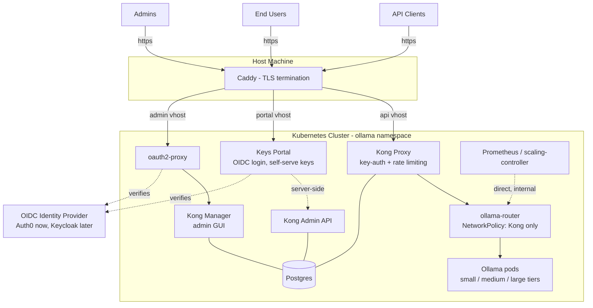

# API Key Plan

Adding API-key authentication to the Ollama stack, with a self-service portal for
end users and an SSO-protected admin console. The guiding constraint: every piece
must run fully self-hosted, and swapping our identity provider (Auth0 today,
Keycloak or similar later) must be a config change, not a code change.

## Key Decisions

- **Unkey is out.** As of 2026 Unkey is a hosted platform; even its local gateway
  validates keys against `api.unkey.com`. It cannot be self-hosted/air-gapped.
- **Kong Gateway (OSS, database-backed) is the API gateway**, placed in-cluster in
  front of the `ollama-router`. It enforces API keys, rate limits, and (later)
  per-consumer attribution before traffic reaches the router and Ollama pods.
- **A custom Keys Portal app for end users.** Users sign in with OIDC (Auth0 now),
  and create/list/revoke *their own* API keys. Kong has no end-user self-serve
  portal in OSS, so this is a small web app we build that talks to the Kong Admin
  API server-side.
- **Kong Manager (bundled admin GUI) stays admin-only**, protected by an
  oauth2-proxy gate using the same OIDC provider.
- **TLS is terminated on the host** by Caddy (or nginx/Traefik), which fronts the
  three public faces: the API, the portal, and the admin console.

## Target Architecture

Request flow for inference: client sends its API key → Kong validates it
(key-auth), applies rate limits, forwards to `ollama-router` → router does its
existing tier-based queueing/routing to Ollama pods.

## Elements to Flag

These are the non-obvious parts that drive the design; treat them as
requirements, not suggestions.

1. **Kong must run in database-backed ("traditional") mode with Postgres.**
   In DB-less mode the Admin API is read-only — no GUI and no portal could
   create keys at runtime. Postgres holds all consumers/keys; it needs backups.

2. **The router must be sealed behind a NetworkPolicy allowing only Kong.**
   Today anything in-cluster (or with a port-forward) can query models for
   free. If direct router access remains, API keys are decorative. Monitoring
   and the scaling-controller keep their existing direct access to `/metrics`
   and `/api/gateway/status` (internal only, not exposed through Kong).

3. **Kong's Admin API (8001) and Manager (8002) must never be reachable from
   outside the cluster.** They are unauthenticated in OSS by default. The
   portal is the *only* path end users have to key management, and the portal
   enforces "you can only touch the consumer mapped to your own login." A
   validated check that these ports refuse external connections belongs in the
   test suite.

4. **Kong Manager is admin-only; there is no per-user scoping in OSS.** Anyone
   behind the oauth2-proxy gate is a full gateway admin (RBAC is an enterprise
   feature). This is exactly why we build the Keys Portal instead of pointing
   users at Manager. The portal auto-provisions one Kong consumer per OIDC
   identity (mapped by the subject claim) on first login.

5. **OIDC is config-only everywhere, so Auth0 → Keycloak is a swap.** The
   portal uses a standard OIDC client (issuer URL, client ID, secret from env);
   oauth2-proxy is configured the same way. Nothing speaks Auth0's API
   directly. This is what keeps the eventual air-gapped story cheap: mirror the
   container images (Kong, Postgres, oauth2-proxy, portal, plus Keycloak) and
   flip config.

6. **LLM streaming shapes the proxy config.** Kong's defaults (60s timeouts,
   response buffering) silently break long token streams. The route fronting
   the router needs buffering disabled and long read/write timeouts, and an
   end-to-end multi-minute streaming test is the gate for "gateway works."

7. **`Authorization: Bearer <key>` needs an explicit convention.** Kong's
   key-auth plugin matches header values literally and does not strip the
   `Bearer ` prefix. Clients here follow OpenAI/Ollama conventions, so we pick
   one: accept `x-api-key`, or normalize the Authorization header before
   key-auth runs. Decide this against the real clients, not in production.

8. **Kong keys = rate limits, not token budgets.** By choosing Kong over
   LiteLLM we accepted that a key controls requests/minute and access, but has
   no notion of tokens or dollar spend. Per-key usage will come later as
   request counts, attributed by injecting a consumer header into the router
   and exposing it through Prometheus. If token-level budgets ever become a
   hard requirement, the portal's gateway adapter was built as an interface
   precisely so LiteLLM could be substituted underneath.

## Out of Scope (for now)

- Per-key token/cost metering and budgets
- Metering/billing or quotas beyond request rate limits
- Replacing the router's tier logic — Kong authenticates and gates; the router
  keeps owning queueing, tier targeting, and interaction with the scaling-controller
- Multi-node Kong (Redis-backed shared rate limiting) — add only if Kong
  itself gets scaled out
